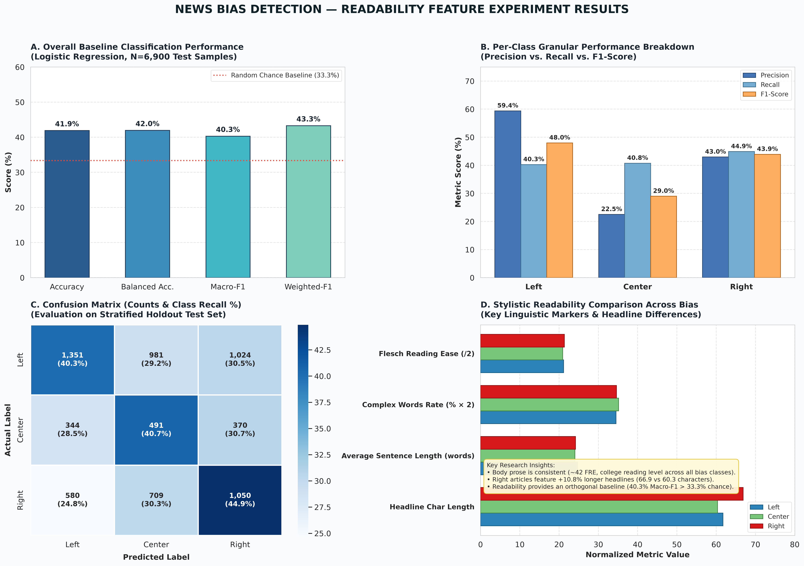

# Readability Feature Experiment

This module implements the **Readability Score** feature extraction, statistical profiling, and baseline machine learning evaluation for the **News Bias Detection** research project.

It investigates whether linguistic accessibility, structural sentence complexity, and syllable-level characteristics differ across political leanings (**Left**, **Center**, and **Right**) in news journalism.

> [!TIP]
> **Need to present or interpret these results in simple words?** Check out [`RESULTS_EXPLANATION.md`](RESULTS_EXPLANATION.md) for a plain-English walkthrough of all terms (F1-score, precision, recall, confusion matrix), what every graph means, and ready-made presentation talking points.

---

## 1. Theoretical Motivation

Media framing and target demographics often correlate with stylistic and syntactic complexity:
- **Populist vs. Institutional Reporting**: Mainstream or institutional reporting often employs formal syntactic structures and higher grade-level vocabulary, whereas sensationalist or tabloid coverage often aims for lower grade levels with punchier sentences.
- **Audience Accessibility**: Outlets targeting broader audiences frequently calibrate their prose to lower reading difficulty thresholds.
- **Headline Punchiness**: Headline readability reflects editorial strategies designed for immediate reader engagement and emotional resonance.

While readability alone is not direct proof of political bias, evaluating readability in isolation establishes an essential stylistic baseline before integrating it into multi-modal/multi-feature ensemble classifiers.

---

## 2. Feature Definitions & Formulas

The module extracts 21 numeric features across the article body (`Text`) and headline (`Title`):

### Composite Readability Indices (Article Body)

| Feature Name | Metric | Mathematical Formula / Description | Typical Scale |
| :--- | :--- | :--- | :--- |
| `flesch_reading_ease` | Flesch Reading Ease (FRE) | $206.835 - 1.015 \times \text{ASL} - 84.6 \times \text{ASW}$ | 0–100 (Higher = Easier to read) |
| `flesch_kincaid_grade` | Flesch-Kincaid Grade Level | $0.39 \times \text{ASL} + 11.8 \times \text{ASW} - 15.59$ | U.S. school grade level (1–18+) |
| `gunning_fog` | Gunning Fog Index | $0.4 \times \left( \text{ASL} + 100 \times \frac{\text{Complex Words}}{\text{Total Words}} \right)$ | U.S. reading grade level |
| `coleman_liau_index` | Coleman-Liau Index (CLI) | $0.0588 \times L - 0.296 \times S - 15.8$<br>($L$: letters per 100 words, $S$: sentences per 100 words) | U.S. reading grade level |
| `automated_readability_index` | Automated Readability Index (ARI) | $4.71 \times \left( \frac{\text{Characters}}{\text{Words}} \right) + 0.5 \times \text{ASL} - 21.43$ | U.S. reading grade level |
| `smog_index` | SMOG Index | $1.0430 \times \sqrt{30 \times \frac{\text{Complex Words}}{\text{Sentences}}} + 3.1291$ | Years of formal education needed |
| `dale_chall_readability_score` | Dale-Chall Score | $0.1579 \times \text{Difficult Words \%} + 0.0496 \times \text{ASL} (+ 3.6365)$ | Grade scale using familiar 3,000 words |
| `linsear_write_formula` | Linsear Write Formula | Points based on 1-syllable vs $\ge 3$-syllable word distribution | U.S. reading grade level |

*Where: $\text{ASL} = \frac{\text{Total Words}}{\text{Total Sentences}}$ (Average Sentence Length), $\text{ASW} = \frac{\text{Total Syllables}}{\text{Total Words}}$ (Average Syllables per Word).*

### Structural & Lexical Components (Article Body)

- `char_count`: Total character length of the article body.
- `word_count`: Total alphabetic word tokens.
- `sentence_count`: Total sentence boundaries.
- `syllable_count`: Total syllables across all words.
- `avg_sentence_length`: Mean words per sentence ($\text{ASL}$).
- `avg_syllables_per_word`: Mean syllable density ($\text{ASW}$).
- `avg_chars_per_word`: Mean letters per word token.
- `complex_word_count`: Total words with 3 or more syllables.
- `complex_word_percentage`: Percentage of complex words ($\frac{\text{complex words}}{\text{words}} \times 100$).
- `polysyllabic_per_1000_words`: Complex words normalized per 1,000 words.

### Headline Features (`Title`)

- `title_word_count`: Headline word token count.
- `title_char_count`: Headline character length.
- `title_flesch_reading_ease`: Headline Flesch Reading Ease score.

---

## 3. How to Redo All Work from Scratch (Reproduction Guide)

If you or another team member want to replicate all feature extraction, visualizations, and baseline evaluations from scratch, follow these exact steps:

### Step 1: Environment Setup
From the repository root, create a Python virtual environment and install the required dependencies:

```bash
# 1. Create a virtual environment
python -m venv .venv

# 2. Activate the virtual environment
# On Windows (PowerShell):
.venv\Scripts\Activate.ps1
# On Windows (Command Prompt):
.venv\Scripts\activate.bat
# On Linux / macOS:
source .venv/bin/activate

# 3. Install required packages
pip install -r readability/requirements.txt
```

### Step 2: Dataset Verification
Ensure the dataset `Combined_Dataset.csv` is present either:
- Directly in the project root: `./Combined_Dataset.csv`
- Or in the `data/` directory: `./data/Combined_Dataset.csv`

*(If you do not have the dataset yet, download it from the Google Drive link provided in [`data/README.md`](../data/README.md) and place it in the project root).*

### Step 3: Run Feature Extraction
Extract all 21 readability and syntactic complexity features across all articles:

```bash
python readability/extract_features.py
```

- **Runtime**: ~45 seconds for all 34,500 articles.
- **Output**: Generates `readability/outputs/features/Combined_Dataset_readability.csv` (preserves original columns and adds stable `Article_ID`).

*(Optional: To test on a small subset first, run `python readability/extract_features.py --limit 100`).*

### Step 4: Run Statistical Profiling and Generate Plots
Compute descriptive statistics and generate presentation-ready distribution boxplots grouped by political leaning:

```bash
python readability/analyze_and_plot.py
```

- **Output**: Generates `readability_statistical_summary.csv` and 5 high-resolution boxplot PNG images in `readability/outputs/plots/`.

### Step 5: Train and Evaluate Baseline Classifier
Train an 80/20 stratified Logistic Regression baseline on readability features only:

```bash
python readability/train_baseline.py
```

- **Output**: Generates accuracy, macro-F1, per-class classification reports, and confusion matrix CSVs in `readability/outputs/results/`.

### Step 6: Generate Executive Results Dashboard Image
Generate a publication-grade, 4-panel visual summary of all key findings:

```bash
python readability/generate_results_dashboard.py
```

- **Output**: Generates `readability_results_dashboard.png` in `readability/outputs/results/` and `00_results_executive_dashboard.png` in `readability/outputs/plots/`.

---

## 4. Directory & Output Structure

All outputs produced by this module are located in `readability/outputs/`:

```
readability/
├── README.md                                  # Complete experiment documentation
├── requirements.txt                           # Dependencies (pandas, scikit-learn, textstat, etc.)
├── extract_features.py                        # High-speed feature extraction script
├── analyze_and_plot.py                        # Statistical analysis and visualization script
├── train_baseline.py                          # Logistic Regression baseline classifier
├── generate_results_dashboard.py              # Visual dashboard generator for presentations
└── outputs/
    ├── features/                              # (Local only - excluded from Git via .gitignore)
    │   ├── Combined_Dataset_readability.csv   # Enriched dataset (34,500 rows, 27 columns)
    │   └── feature_extraction_summary.csv     # Input/output row audit
    ├── plots/                                 # (Tracked in Git)
    │   ├── 00_results_executive_dashboard.png  # Executive results dashboard visual
    │   ├── readability_statistical_summary.csv # Mean, median, std grouped by bias
    │   ├── 01_composite_readability_scores.png # FRE, FKGL, Gunning Fog, ARI boxplots
    │   ├── 02_grade_level_indices.png          # Coleman-Liau, SMOG, Dale-Chall boxplots
    │   ├── 03_structural_complexity.png        # ASL, ASW, Chars/Word boxplots
    │   ├── 04_complex_word_distribution.png    # Complex word % and Polysyllabic rate boxplots
    │   └── 05_headline_readability.png         # Headline length and reading ease boxplots
    └── results/                               # (Tracked in Git)
        ├── readability_results_dashboard.png   # 4-panel executive results visual
        ├── readability_results.csv             # Overall evaluation metrics
        ├── readability_classification_report.csv # Precision, recall, F1 per bias class
        └── confusion_matrices/
            └── Combined_Dataset_confusion_matrix.csv # Actual vs predicted distribution
```

---

## 5. Visual Results Dashboard

The generated executive dashboard summarizes all core experimental results in a single presentation-grade visual:



---

## 6. Experimental Results & Findings

### Statistical Summary Across Political Leanings (34,500 articles)

| Feature | Metric | Center (6,025 articles) | Left (16,781 articles) | Right (11,694 articles) |
| :--- | :--- | :--- | :--- | :--- |
| **Flesch Reading Ease** | Mean / Median | 41.86 / 43.48 | 42.29 / 43.63 | 42.72 / 44.12 |
| **Flesch-Kincaid Grade** | Mean / Median | 13.39 / 12.73 | 13.50 / 12.94 | 13.30 / 12.76 |
| **Gunning Fog Index** | Mean / Median | 16.65 / 16.04 | 16.79 / 16.24 | 16.59 / 16.04 |
| **Average Sentence Length** | Mean / Median | 24.05 / 22.39 words | 24.73 / 23.30 words | 24.17 / 22.67 words |
| **Complex Word Percentage**| Mean / Median | 17.58% / 17.24% | 17.25% / 16.94% | 17.30% / 17.02% |
| **Headline Char Length** | Mean / Median | 60.34 / 60.00 chars | 61.71 / 62.00 chars | 66.87 / 68.00 chars |

#### Observations:
1. **Body Prose Consistency**: News articles across Left, Center, and Right exhibit comparable body readability (mean FRE ~42, requiring college-level comprehension).
2. **Headline Distinction**: Right-leaning articles tend to have noticeably longer headlines (mean 66.87 characters vs 60.34 for Center and 61.71 for Left), reflecting stylistic headline formatting differences.

### Baseline Logistic Regression Performance (80/20 Stratified Holdout Split)

- **Total Samples**: 34,500 articles (Train: 27,600 | Test: 6,900)
- **Model**: StandardScaler + Logistic Regression (`class_weight='balanced'`, `random_state=42`)
- **Overall Accuracy**: **41.91%**
- **Balanced Accuracy**: **41.96%**
- **Macro-F1**: **0.4030**
- **Weighted-F1**: **0.4329**

#### Per-Class Breakdown:

| Class | Precision | Recall | F1-Score | Support |
| :--- | :---: | :---: | :---: | :---: |
| **Left** | 0.5938 | 0.4026 | **0.4798** | 3,356 |
| **Center** | 0.2251 | 0.4075 | **0.2900** | 1,205 |
| **Right** | 0.4296 | 0.4489 | **0.4391** | 2,339 |

#### Confusion Matrix (Test Set, N = 6,900):

| Actual \ Predicted | Predicted Left | Predicted Center | Predicted Right |
| :--- | :---: | :---: | :---: |
| **Actual Left** | **1,351** | 981 | 1,024 |
| **Actual Center** | 344 | **491** | 370 |
| **Actual Right** | 580 | 709 | **1,050** |

---

## 6. Takeaway & Integration with Other Features

Readability and syntactic metrics provide a purely structural lens on journalistic tone. A baseline Macro-F1 of **0.4030** using only readability metrics confirms that reading level alone carries modest predictive signal. 

When combined with lexical sentiment polarity (from the [`sentiment/`](../sentiment/) module) and punctuation pacing (from the [`Punctuation/`](../Punctuation/) module), readability features will contribute essential orthogonal variance to the final multi-feature bias classification model.
